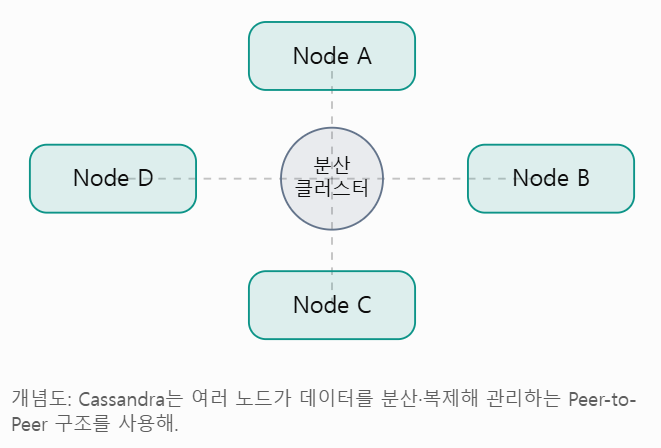
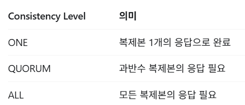
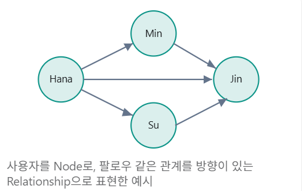

# 7. 대표적인 NoSQL 정리

## **NoSQL 분류**

6장에서 간단히 정리한 NoSQL을 자세히 정리해보려고 한다. NoSQL의 종류는 다음과 같음을 정리했었다.

| NoSQL 종류                 | 특징                                      | 대표 DB              | 사용 사례                  |
| -------------------------- | ----------------------------------------- | -------------------- | -------------------------- |
| **Key-Value Store**        | 키 하나에 값 하나를 저장                  | **Redis**, Memcached | 캐시, 세션, 카운터         |
| **Document**               | Json과 유사한 문서 형태로 데이터 저장     | MongoDB              | 유연한 스키마, 콘텐츠      |
| Column Store (Wild-Column) | 분석 저장과 대규모 읽기, 쓰기 처리에 활용 | Cassandra            | 이벤트 로그, 시계열 데이터 |
| Graph                      | 노드와 관계를 중심으로 데이터 저장        | Neo4j                | 추천, 소셜 관계 탐색       |

각 종류별로 대표적인 DB를 자세히 알아보자.

<br>

### **1. Redis > Key-Value NoSQL**

#### **Redis란?**

**Redis**는 **메모리를 중심**으로 데이터를 저장하고 처리하는 고성능 데이터 저장소이다.

기본적으로 **Key-Value 모델**을 사용하지만, 단순한 문자열 뿐만 아니라 List, Set, Hash, Sorted Set 등 **다양한 자료구조를 지원**한다.

예를 들어 다음과 같이 데이터를 저장하고 조회할 수 있다.

```
SET user:1:name "hana"
GET user:1:name // hana 반환
```

#### **Redis가 빠른 이유**

Redis의 성능 특성을 이해하기 위해 세 가지 특성을 알아야 한다.

<br>

**1. 메모리 기반**

Redis는 데이터를 디스크가 아닌 **메모리에 저장**한다. 따라서 **디스크 I/O로 인한 병목 현상을 줄일 수** 있어 빠른 속도로 데이터를 읽고 쓸 수 있다.

> 반면 MySQL의 InnoDB는 디스크에 데이터를 영속적으로 저장하고, Buffer Pool로 자주 쓰는 페이지를 메모리에 캐싱한다.

**2. 효율적인 자료구조**

Redis는 다양한 자료구조를 지원한다. 단순한 문자열 뿐만 아니라, List, Set, Hash, Sorted Set 등 다양한 자료구조를 제공한다. 이러한 **자료구조는 특정 상황에서 데이터를 효율적으로 처리**할 수 있게 해준다.

예를 들어 **GET은 평균적으로 O(1)**, **Sorted Set의 ZADD는 일반적으로 O(log N)** 의 시간복잡도를 갖는다.

**3. 싱글 스레드 모델**

Redis는 명령 실행의 핵심 부분을 **단일 스레드 기반으로 처리**해왔다.

현재는 네트워크 I/O 등 일부 작업에 여러 스레드를 활용할 수 있으나, 일반적인 명령은 주로 순차적으로 이루어진다.

이러한 특성 덕분에 명령 실행 도중 다른 명령어가 끼어들지 않아 **원자적 처리가 가능**하다.

<br>

#### **Redis의 주요 자료구조**

Redis는 다양한 자료구조를 지원한다. 각 자료구조의 특징과 사용 사례를 정리하면 다음과 같다.

| 자료구조       | 특징                                                                                                                                              | 대표 명령어         | 사용 사례          |
| -------------- | ------------------------------------------------------------------------------------------------------------------------------------------------- | ------------------- | ------------------ |
| **String**     | 가장 단순한 자료구조, 문자열 저장                                                                                                                 | SET, GET, INCR      | 캐시, 세션, 카운터 |
| **Hash**       | 하나의 Key 아래에 필드-값(Field-Value) 쌍을 여러 개 저장                                                                                          | HSET, HGET, HGETALL | 사용자 속성        |
| List           | 데이터가 삽입된 순서(Ordered)를 유지하는 문자열 집합으로, 양방향으로 데이터를 넣고 빼기 편리                                                      | LPUSH, RPOP         | 대기열             |
| **Set**        | 순서가 없고 중복을 허용하지 않는 데이터 집합                                                                                                      | SADD, SISMEMBER     | 중복제거           |
| **Sorted Set** | Set의 특성(중복 없음)을 가지면서, 모든 요소가 Score(점수)라는 실수값을 함께 가지고 있어서 이 점수를 기준으로 자동 오름차순/내림차순 정렬이 유지됨 | ZADD, ZRANGE        | 랭킹, 점수정렬     |
| Stream         | 로그나 이벤트 스트림을 누적해서 기록 가능                                                                                                         | XADD, XREADGROUP    | 이벤트처리         |

<br>

#### **Redis 캐싱 전략**

Redis를 사용하는 대표적인 이유 중 하나가 바로 **캐싱**이다.

**Cache-Aside (Lazy Loading)**

이 전략의 동작 순서는 다음과 같다.

1. 애플리케이션이 Redis에서 데이터를 조회한다.
2. 캐시가 존재하면 **(Cache Hit)** 즉시 반환한다.
3. 캐시가 없으면 **(Cache Miss)** DB에서 조회한다.
4. **DB 조회 결과를 Redis에 저장하고 반환**한다.

<br>

이렇게 Redis에 캐시를 도입하면 어떤 문제가 발생할 수 있을까? 대표적인 문제는 다음과 같다.

- **Cache Stampede**
  - **캐시가 만료**되어 DB에 동시에 많은 요청이 몰리는 현상
- **Cache Penetration**
  - **존재하지 않는 데이터를 반복적으로 조회**해 DB에 부하가 발생하는 현상
- **Cache Inconsistency**
  - **DB 데이터와 캐시 데이터가 서로 달라지는** 현상

위 문제들에 대한 해결책으로는 **TTL에 무작위 값**을 추가하거나, **Null 캐싱**, **캐시 무효화** 등이 있다.

<br>

#### **Redis의 TTL과 메모리 관리**

Redis는 메모리 기반이기 때문에, 메모리 관리가 매우 중요하다. Redis는 **TTL(Time To Live)** 을 지원하여, 특정 Key에 대해 만료 시간을 설정할 수 있다.

```
SET auth:1234 "verified" EX 300
TTL auth:1234
```

EX 300은 300초 후 해당 Key가 만료되도록 설정하는 명령이다. 다만, **TTL이 끝났다고 바로 메모리에서 삭제되지는 않는다.**

Redis는 주로 다음과 같은 방식들로 만료된 Key를 제거한다.

- **Passive Expiration**
  - **Key에 접근했을 때** 만료여부 확인 후 삭제
- **Active Expiration**
  - **백그라운드에서** 만료된 Key를 주기적으로 탐색하고 삭제

또한 메모리가 부족해지면 설정된 **maxmemory-policy에 따라 Key를 제거하거나 새로운 쓰기 요청을 거부**할 수 있다! 대표적인 정책에는 **allkeys-lru, allkeys-lfu, volatile-ttl, noeviction** 등이 있다.

<br>

#### **Redis의 영속성**

Redis는 메모리 기반이기 때문에, 서버가 종료되면 데이터가 사라진다. 따라서 영속성을 위해 다음과 같은 방법을 제공한다.

- **RDB (Redis Database) Snapshot**
  - **주기적으로 데이터를 스냅샷**으로 저장하는 방식
  - 목적: 영속성, 백업
  - 장점: 빠른 복구
  - 단점: 데이터 손실 가능성 존재

- **AOF (Append Only File)**
  - 데이터 변경 명령을 **로그**로 기록
  - 목적: 영속성, 복구
  - 장점: 설정에 따라 데이터 손실 구간을 줄일 수 있음
  - 단점: 로그 기록·재작성에 따른 오버헤드

<br>

### **2. MongoDB > Document NoSQL**

#### **MongoDB란?**

**MongoDB**는 **Document 기반 NoSQL** 데이터베이스이다. 데이터를 **JSON과 유사한 BSON(Binary JSON) 형태**로 저장하며, **유연한 스키마**를 제공한다.

예를 들어 MySQL에서는 아래처럼 사용자와 주문을 각각의 테이블로 분리한다.

```
users
+----+-------+
| id | name  |
+----+-------+
| 1  | hana  |
+----+-------+

orders
+----+---------+---------+
| id | user_id | product |
+----+---------+---------+
| 10 | 1       | Book    |
+----+---------+---------+
```

반면 MongoDB에서는 다음과 같이 관련 데이터를 하나의 Document에 포함할 수 있다.

```
{
  "_id": 1,
  "name": "hana",
  "orders": [
    {
      "orderId": 10,
      "product": "Book"
    }
  ]
}
```

이렇게 **하나의 문서에 포함하는 방식을 Embedding**이라고 한다.

<br>

#### **Embedding과 Referencing**

**Embedding**은 함께 조회하는 **데이터를 한 문서에 포함**하는 것이다. 함께 조회하는 데이터에는 유리하지만, 데이터가 계속 증가하면 **문서가 비대해질 수** 있다.

**Referencing**은 **다른 문서의 ID를 참조**하는 방식이다. 데이터가 계속 증가해도 문서 크기가 커지지 않고 **독립적인 변경에 유리**하지만, 관련 데이터를 조회하려면 **추가 쿼리나 $lookup이 필요**할 수 있다.

```
// embedding
{
  "user": "hana",
  "profile": {
    "age": 24,
    "city": "Seoul"
  }
}

// referencing
{
  "user": "hana",
  "profileId": 10
}
```

따라서 MongoDB에서는 RDB의 정규화 원칙을 그대로 적용하기 보다는, **데이터를 어떻게 읽고 수정하는지를 중심으로 모델링**하는 경우가 많다.

<br>

#### **MongoDB의 인덱스**

MongoDB의 일반적인 인덱스는 B-tree 계열 구조를 사용하며, 복합인덱스, 멀티키 인덱스 등도 지원한다.

인덱스가 없으면 컬렉션 전체를 탐색하는 COLLSCAN이 발생할 수 있다.

아래처럼 인덱스를 생성할 수 있다.

```
db.users.createIndex({ email: 1 })
```

<br>

#### **MongoDB의 트랜잭션과 일관성**

NoSQL은 트랜잭션을 지원하지 않는다는 오해가 많지만, 사실 트랜잭션을 지원한다.

MongoDB는 4.0 버전부터 **다중 문서 트랜잭션**을 지원한다. 단일 문서에 대한 작업은 원자적이지만, **여러 문서에 걸친 작업은 트랜잭션을 통해 처리**할 수 있다. 다만 여러 문서를 함께 수정하는 트랜잭션은 추가적인 비용이 발생할 수 있어 **모델링 단계에서 데이터를 적절히 배치**하는 게 좋다.

추가로 MongoDB는 **Replica Set과 Sharding**을 통해 **고가용성과 수평확장**을 지원한다.

<br>

### **3. Cassandra > Wide-Column NoSQL**

#### **Cassandra란?**

Apache Cassandra는 여러 서버에 데이터를 분산 저장하도록 설계된 NoSQL 데이터베이스이다.

특히 대규모 데이터와 **높은 쓰기처리량**, 여러 노드에 걸친 **고가용성이 중요한 시스템**에서 주로 사용한다. 사용 예시는 다음과 같다.

- **IoT 데이터 수집**: 센서 데이터, 로그 데이터 등
- **대규모 이벤트 로그**
- **사용자 활동 기록**
- **시계열 데이터**

<br>

#### **Cassandra의 분산 구조**



Cassandra는 기본적으로 단일 마스터가 모든 쓰기를 관리하지 않고 **Peer-to-Peer 구조**를 사용한다. 데이터는 Partition Key를 기반으로 분산되며, Replication Factor 설정에 따라 여러 노드에 복제될 수 있다.

#### **Partition Key와 Clustering Column**

Cassandra에서 데이터를 저장할 때, **Partition Key**와 **Clustering Column**을 사용하여 데이터를 분류하고 정렬한다.

```SQL
CREATE TABLE user_events (
    user_id UUID,
    event_time TIMESTAMP,
    event_type TEXT,
    PRIMARY KEY (user_id, event_time)
);
```

- userId : **Partition Key**
- eventTime : **Clustering Column**

**Partition Key**는 데이터가 **어떤 파티션에 속하는지**를 결정하고, **Clustering Column**은 파티션 내부에서 **데이터의 정렬 순서**에 영향을 준다.

Cassandra는 임의의 컬럼을 자유롭게 조회하기 보다는 **미리 정해진 조회 패턴에 맞춰 테이블을 설계**하는 게 중요하다.

#### **Cassandra의 일관성**

Cassandra는 **읽기와 쓰기에 대해 Consistency Level을 설정**할 수 있다.



일반적으로 일관성 요구 수준을 높이면 **더 많은 복제본의 응답이 필요해져 가용성과 지연 시간에 영향**을 줄 수 있다.

복제본 수가 N일 때 읽기 요구 수 R, 쓰기 요구 수 W가 **R + W > N**을 만족하도록 설정하면 **정상적인 복제본 중첩을 확보**할 수 있지만, 이것만으로 모든 장애 상황에서 강한 일관성이 보장되진 않는다.

<br>

### **4. Neo4j > Graph-NoSQL**

#### **Graph Database란?**

Graph Database는 **노드(Node)와 관계(Relationship)**를 중심으로 데이터를 저장하는 데이터베이스이다.

예를 들면 SNS에서 사용자의 팔로우 관계를 저장하는 것을 생각해볼 수 있다.



Neo4j에서는 다음과 같은 Cypher 쿼리를 사용할 수 있다.

```cypher
// hana가 팔로우하는 사용자를 찾는 쿼리
MATCH (a:User {name: "Hana"})-[:FOLLOWS]->(b:User)
RETURN b
```

#### **RDB와 Graph DB의 차이는?**

RDB에서는 친구의 친구를 조회하려면 자기 참조 JOIN을 여러번 수행할 수 있다.

```SQL
SELECT f2.followee_id
FROM follows f1
JOIN follows f2
  ON f1.followee_id = f2.follower_id
WHERE f1.follower_id = 1;
```

Graph DB에서는 관계를 따라 탐색하는 방식으로 구현할 수 있다.

```
MATCH (a:User {id: 1})-[:FOLLOWS]->()-[:FOLLOWS]->(b:User)
RETURN b
```

관계의 깊이가 증가하거나 복잡한 연결 패턴을 탐색해야 할 때 Graph DB가 유리할 수 있으나, 단순한 관계 조회는 RDB로 충분하다.
