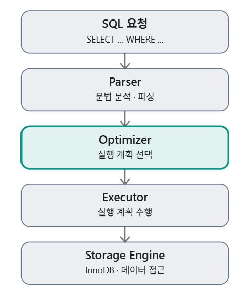
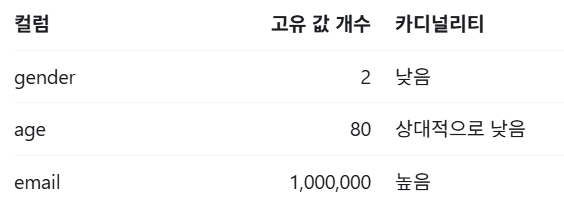
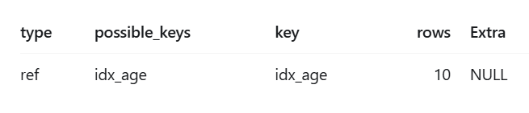
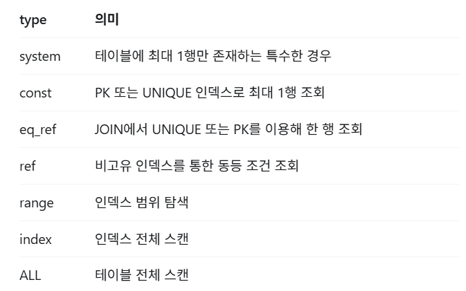
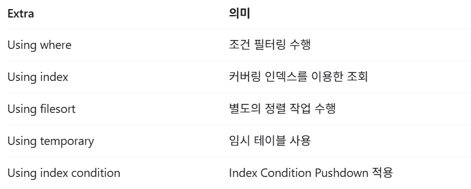

# 8. 쿼리 최적화

## **SQL 쿼리는 어떻게 실행될까?**

다음 SQL을 실행한다고 가정해보자

```SQL
SELECT *
FROM users
WHERE age = 25;
```

MySQL은 SQL을 전달받고 무조건 테이블의 모든 데이터를 읽지 않는다. 먼저 SQL을 분석하고, 어떤 방식으로 조회할지 결정한다.



### Parser (파서)

SQL을 분석하는 단계로, **SQL 문법에 맞는지 확인**하고, 내부적으로 사용되는 **AST(Abstract Syntax Tree)** 를 생성한다.

### **Optimizer (옵티마이저)**

Optimizer는 SQL을 실행하기 위한 **최적의 실행 계획**을 수립하는 단계이다.

예를들어 age 칼럼에 인덱스가 있으면 다음과 같은 선택지가 있다.

- 테이블의 모든 행을 읽는 Full Table Scan
- age 인덱스를 사용해 필요한 행을 찾는 Index Scan

옵티마이저는 예상 비용을 비교해 실행 계획을 선택한다.

### **Executor (실행기)**

Executor는 실제로 SQL을 실행하는 단계이다. 옵티마이저가 선택한 실행 계획에 따라 데이터를 읽고, 필요한 연산을 수행한다.

### Storage Engine (스토리지 엔진)

Storage Engine은 **실제 데이터를 저장하고 관리하는 역할**을 한다. MySQL은 여러 스토리지 엔진을 지원하며, 대표적으로 **InnoDB와 MyISAM**이 있다.

<br>

## **옵티마이저란? (Optimizer)**

옵티마이저는 SQL을 실행하기 위한 **최적의 실행 계획**을 수립하는 단계이다.

### **비용 기반 옵티마이저 (CBO)**

MySQL은 비용 기반 옵티마이저를 사용한다. 여기서 비용은 단순히 **실행 시간** 뿐만 아니라, 예상 **데이터 접근량, IO비용, CPU 연산 비용** 등 여러 요소를 고려한 추정치이다.

예를 들어 다음 테이블이 있다.

```SQL
CREATE TABLE users (
    id BIGINT PRIMARY KEY,
    name VARCHAR(50),
    age INT,
    INDEX idx_age (age)
);
```

총 100만명의 사용자가 있고, 나이가 25살인 데이터를 찾는 상황이라고 가정해보자.

#### **상황1 - age = 25가 10명일 때**

인덱스를 이용하면 소수의 행을 찾을 수 있으므로 유리할 수 있다. 풀스캔하면 100만개를 탐색해야 하기 떄문에 불리하다.

#### **상황2 - age = 25가 90만명일 때**

인덱스를 이용하면 90만개의 행을 찾아야 하므로, 풀스캔하는 것이 더 효율적일 수 있다.

따라서 인덱스가 존재한다고 해서 반드시 인덱스를 사용하지는 않는다!

<br>

### **선택도와 카디널리티 (Selectivity & Cardinality)**

카디널리티는 칼럼에 존재하는 서로 다른 값의 개수를 의미한다.



선택도는 **조건에 의해 데이터가 얼마나 좁혀지는지**를 나타내는 개념이다. 쉽게 생각하면 **조건에 일치하는 행 수 / 전체 행 수** 로 생각하면 된다.

**일치 비율이 낮을수록 소수의 행만 조회하므로 인덱스가 유리**한 경우가 많다! 다만 카디널리티 만으로 인덱스의 효율성이 결정되지는 않기 때문에, 데이터으 분포, 쿼리조건, 커버리 인덱스 여부도 같이 확인해야 한다.

### **옵티마이저가 항상 최적의 계획을 선택할까**

옵티마이저는 예상 비용을 기반으로 실행 계획을 선택하지만, 항상 최적의 계획을 선택하는 것은 아니다. 데이터 분포가 바뀌거나 통계 정보가 오래되면 잘못된 선택을 할 수 있다.

필요한 경우 **ANALYZE TABLE**로 통계 정보를 갱신하거나, 쿼리와 인덱스 구조를 개선할 수 있다.

<br>

## **실행계획 (EXPLAIN) 분석**

**EXPLAIN** 은 MYSQL이 SQL을 어떤 방식으로 실행할 예정인지 확인하는 명령어이다.

```SQL
EXPLAIN
SELECT *
FROM users
WHERE age = 25;
```

결과는 다음처럼 나온다. 각 항목을 해석해보자.



### **type - 테이블 접근 방식**

가장 중요한 칼럼 중 하나이다.



일반적으로 **ALL은 많은 데이터를 읽을 수 있어** 주의깊게 확인해야 한다. 단, 테이블이 매우 작거나 **대부분의 데이터를 조회하는 경으 Full Table Scan이 합리적**일 수 있다.

#### **EX| PK 조회**

id가 pK라면 일반적으로 const 접근이 가능해서 한 번에 데이터에 접근할 수 있다.

```SQL
EXPLAIN
SELECT *
FROM users
WHERE id = 1;
```

#### **EX| 범위 조회**

age 인덱스를 활용하면 range가 나올 수 있다.

```SQL
EXPLAIN
SELECT *
FROM users
WHERE age BETWEEN 20 AND 30;
```

### **possible_keys와 key**

possible_keys는 옵티마이저가 **사용할 수 있는 인덱스 후보**를 보여주고, key는 실제로 선택된 인덱스를 보여준다.

```
possible_keys: idx_age, idx_name
key: idx_age
```

### **rows - 예상 탐색 행 수**

rows는 옵티마이저가 예상하는 **탐색해야 하는 행 수**를 보여준다. 이 값이 크면 많은 데이터를 읽어야 하므로 성능에 영향을 줄 수 있다.

과하게 큰 경우 불필요한 데이터 접근이 발생하는지 확인해볼 필요가 있다.

```
rows: 500000
```

### **extra - 추가 실행 정보**

extra는 옵티마이저가 선택한 실행 계획에 대한 **추가적인 정보를 제공**한다.



#### **Using filesort**

```SQL
SELECT *
FROM users
ORDER BY age DESC;
```

정렬에 적합한 인덱스를 활용하지 못하면 **별도의 정렬 작업**이 필요할 수 있다.

**Using filesort**는 **정렬 알고리즘을 사용한다는 의미**이고, 꼭 디스크 파일에 정렬 데이터를 기록한다는 의미는 아니다.

#### **Using temporary**

```SQL
SELECT age, COUNT(*)
FROM users
GROUP BY age;
```

**그룹화나 정렬 등의 과정에서 내부 임시 테이블**을 사용할 수 있다. 임시 테이블을 쓴다고 해서 무조건 문제는 아니며, 데이터 규모와 실행 비용을 확인해야 한다.

<br>

## **인덱스를 제대로 활용하지 못하는 쿼리**

### **인덱스 컬럼에 함수 적용**

```SQL
-- 비효율적일 수 있는 쿼리
SELECT *
FROM orders
WHERE YEAR(created_at) = 2026;
```

created_at에 일반 B-tree 인덱스가 있어도 **함수 적용 때문에 해당 인덱스의 범위 탐색을 활용하기 어려울** 수 있다! 다음과 같이 변경하면 인덱스 범위 탐색이 가능할 수 있다.

```SQL
SELECT *
FROM orders
WHERE created_at >= '2026-01-01'
  AND created_at < '2027-01-01';
```

MySQL은 함수 기반 인덱스도 지원하므로 모든 함수 사용이 인덱스를 불가능하게 하는 건 아니다!

### **LIKE 검색**

```SQL
-- 일반 B-tree 인덱스의 범위 탐색에 유리
SELECT *
FROM users
WHERE name LIKE 'Kim%';

-- 일반 B-tree 인덱스의 범위 탐색에 불리
SELECT *
FROM users
WHERE name LIKE '%Kim';
```

일반적인 B-tree 인덱스는 **왼쪽부터 정렬된 구조를 활용**하므로 **앞부분이 고정된 검색에 유리**하다. 반대로 앞부분이 불명확하면 효율적인 탐색이 힘들다.

부분 문자열 검색이 중요한 경우 **Full-Text Search나 별도 검색 엔진**을 검토하는 것이 좋다.

### **묵시적 형변환**

```SQL
SELECT *
FROM users
WHERE phone_number = 123456789;
```

phone_number가 문자열 타입이라면 숫자와 비교하는 과정에서 **형변환이 발생**할 수 있다.

컬럼에서 **형변환이 적용되면 인덱스 활용에 불리**하므로, 컬럼 타입에 맞춰 비교하는게 좋다.

> **🔗 형변환이 인덱스 활용에 불리한 이유**
>
> B-Tree 인덱스는 칼럼의 원래 데이터 타입과 정렬 규칙을 기준으로 구성되는데, 형변환이 이루어지면 변환된 값의 비교 규칙이 기존 인덱스 정렬 순서와 달라질 수 있기 때문이다.

### **복합 인덱스와 칼럼 순서**

복합 인덱스는 여러 칼럼을 묶어서 만든 인덱스이다. 하지만 **칼럼 순서에 따라 인덱스 활용 여부가 달라질 수 있다.**

일반적인 **B-tree 복합 인덱스는 왼쪽 칼럼부터 정렬**된다.

```SQL
CREATE INDEX idx_user_status_created
ON orders(user_id, status, created_at);

-- 인덱스 활용에 유리
SELECT *
FROM orders
WHERE user_id = 1
  AND status = 'PAID';

  -- 인덱스 활용이 제한적일 수 있음
SELECT *
FROM orders
WHERE status = 'PAID';
```

MySQL 8.0에는 Index Skip Scan 같은 최적화가 존재하므로 선행 컬럼 조건이 없다고 해서 인덱스를 절대 사용하지 않는 것은 아니다!
