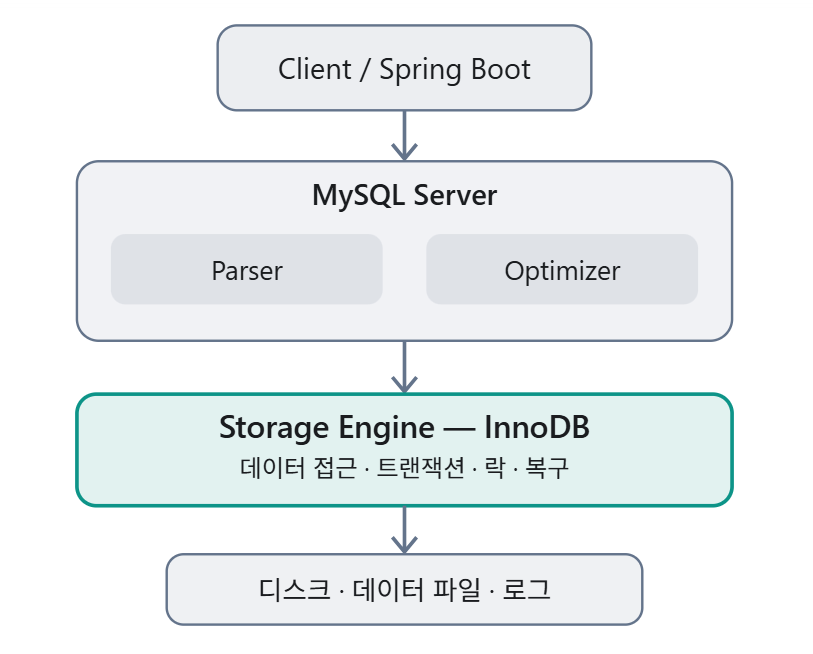
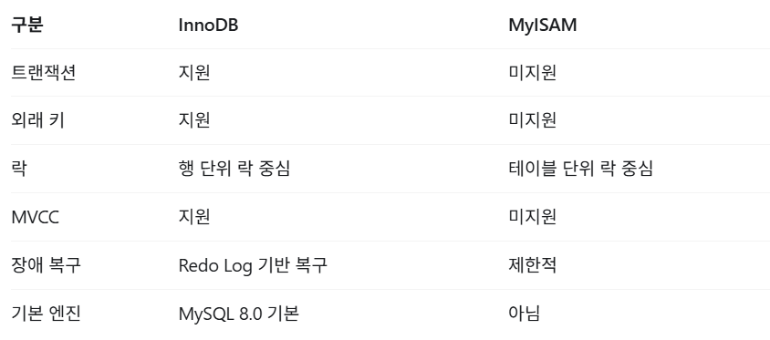
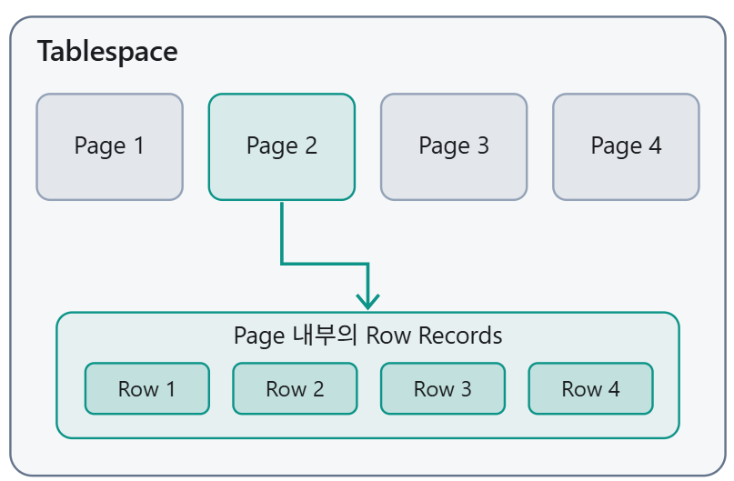
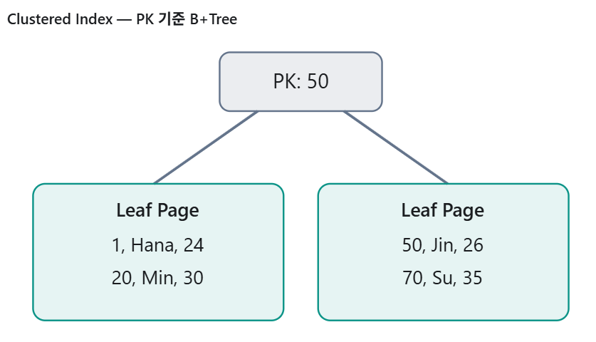
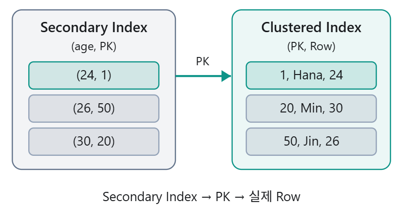

# 9. 스토리지 엔진 (InnoDB & MVCC 심화)

해당 정리는 MySQL 8.0 innoDB 기준으로 한다.

## **스토리지 엔진이란?**

스토리지 엔진은 MySQL에서 **데이터를 저장하고 관리하는 방법을 정의**하는 핵심 구성 요소이다. MySQL은 크게 **SQL을 처리**하는 영역과 **데이터를 저장/관리**하는 **스토리지 엔진** 영역으로 나눠서 생각할 수 있다.



예를 들어 다음 SQL을 실행한다고 해보자.

```SQL
UPDATE users
SET balance = balance - 10000
WHERE id = 1;
```

MySQL Server는 SQL을 분석하고 실행 계획을 결정한다. 이후 InnoDB가 실제 **데이터 페이지를 읽고, 필요한 락을 획득하고, 데이터를 수정하고, 복구를 위한 로그를 관리**한다.

### **InnoDB와 MyISAM 차이**



InnoDB는 트랜잭션과 동시성, 데이터 정합성이 중요한 일반적인 백엔드 서비스에 적합하다. Redo Log와 Undo Log를 활용해 장애 복구와 트랜잭션 롤백을 지원한다!

<br>

## **InnoDB의 데이터 저장 구조**

InnoDB를 이해하려면 다음 세 가지를 알아야 한다.

```
Tablespace → Page → Row
```



### **Tablespace**

**테이블과 인덱스 데이터를 저장하는 논리적 저장 공간**이다. 일반적으로 innodb_file_per_table 설정이 활성화되어 있으면 테이블별 .ibd 파일이 생성된다.

### **Page**

**InnoDB에서 데이터를 저장하는 최소 단위**이다. 일반적으로 16KB 크기이며, **테이블의 행 데이터와 인덱스 데이터가 Page 단위로 저장**된다.

**디스크에서 데이터를 읽거나 쓸 때도 페이지단위로 관리**한다.

### **Row**

페이지 안에는 **실제 데이터 레코드**가 저장된다. 여기서 중요한 건 InnoDB가 단순히 행들을 순서대로 나열해 저장하는 게 아니라, **Clustered Index의 B+Tree 구조를 통해 데이터를 관리한다는 것**이다.

<br>

## **Clustered Index와 Secondary Index**

### **1. Clustered Index**

InnoDB에서는 테이블의 실제 행 데이터가 Clustered Index의 리프 페이지에 저장된다. 일반적으로 PK가 Clustered Index로 사용된다.

아래 그림처럼 리프 페이지에 **PK와 실제 행 데이터가 함께 저장**된다.



따라서 PK를 통해 데이터를 조회하면 **Clustered Index에서 해당 레코드를 직접 찾을 수 있다.** 매우 효율적인 조회 방식이다.

```SQL
SELECT *
FROM users
WHERE id = 1;
```

### **2. Secondary Index**

Secondary Index의 리프 레코드에는 일반적으로 인덱스 컬럼 값과 Primary Key 값이 저장된다.

예를들어 age에 인덱스가 있다면 다음과 같은 구조가 된다.



다음 SQL을 실행하면 어떻게 될까?

```SQL
SELECT name
FROM users
WHERE age = 24;
```

일반적으로 다음 과정이 발생한다.

1. Secondary Index에서 age = 24인 레코드를 찾는다.
2. 해당 인덱스 레코드에 저장된 PK를 얻는다.
3. Clustered Index에서 PK로 실제 행을 조회한다.
4. name을 반환한다.

이처럼 Secondary Index에서 PK를 이용해 실제 행을 다시 찾는 과정을 흔히 **테이블 룩업(또는 북마크 룩업)** 이라고 한다.

**필요한 컬럼이 모두 Secondary Index에 존재**하면 Clustered Index에 다시 접근하지 않아도 된다! 이게 바로 **커버링 인덱스**이다.
